# Dynamic Energy House Card

A Home Assistant dashboard card that shows your home's energy flows on a cut-away house. Solar, grid, batteries, cars, heat pump, appliances, water and rooms appear in the picture only when you add them. Power flows run along routes you define, with your own colours and line positions. Weather, time of day, season, sun and moon are live.

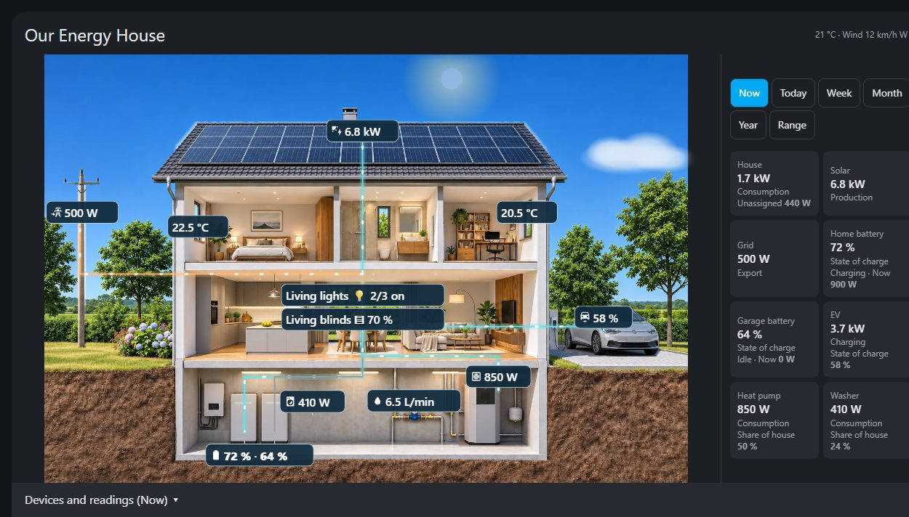

## Live in action

The picture is animated: power pulses along the routes in their direction, clouds drift, rain, snow and hail fall, lightning flashes, and at night the rooms light up.

| Sunny summer day | Thunderstorm at dusk |
|---|---|
| 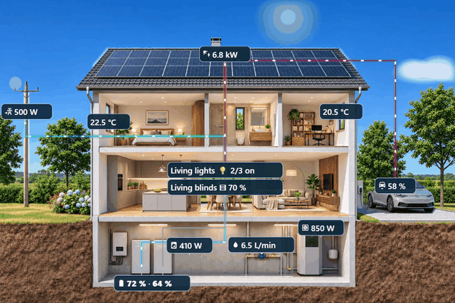 | 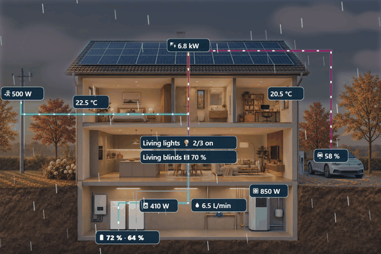 |
| **Snow in winter** | **Rainy spring night** |
| 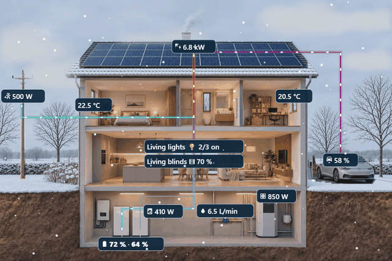 | 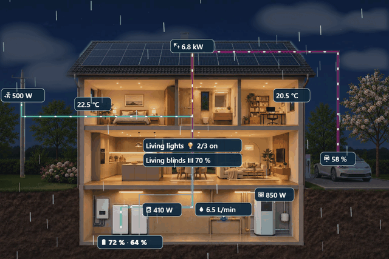 |

## The picture follows your configuration

Start with nothing but the grid connection, then add modules. Each module brings its part of the picture: solar panels on the roof, the power pole, the car at the wallbox, battery cabinets and inverter, heat pump, washing machine, water meter, and a label for every room.

| Grid only | Everything added |
|---|---|
| 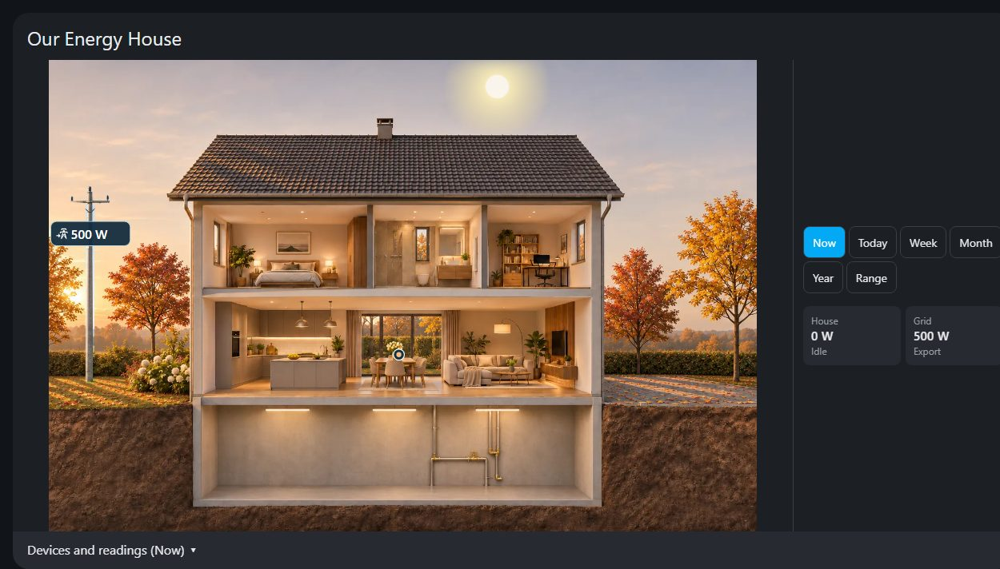 |  |

Rooms take any number of entities or groups: lights and light groups, covers and cover groups, switches, climate and sensors. Each entity gets its own row in the label (lights on, average cover position, temperature). Tap a row to open its HA dialog. Tap the room dot to switch the room's lights and covers.

## Routes and colours are yours

Routes are the lines the power runs along. You decide which modules they connect, which sensor measures them (one per direction if needed), the colour for positive and negative power, and where the line runs: at a height you choose or through any number of waypoints.

| Module settings | Route settings |
|---|---|
| 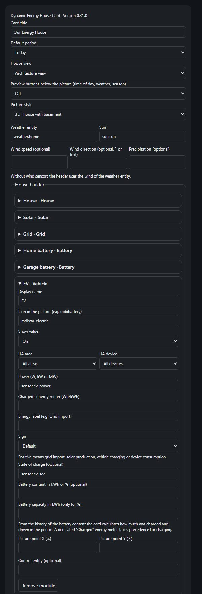 | 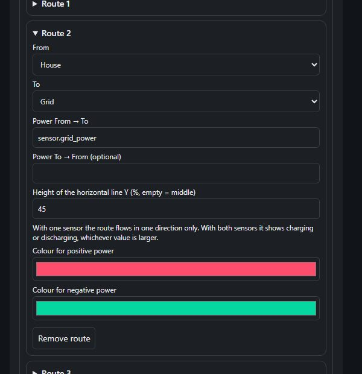 |

## Weather, seasons, sun and moon

The weather entity drives clouds, rain, snow, hail, thunderstorms, fog and wind. The season follows the date, day and night follow the sun with a blend at dusk. The sun and moon stand where they are in the sky, calculated from the time and your HA location (east is left). The moon only appears when it is above the horizon and shows its real phase.

| Night with moon | Blueprint style in the rain |
|---|---|
|  | 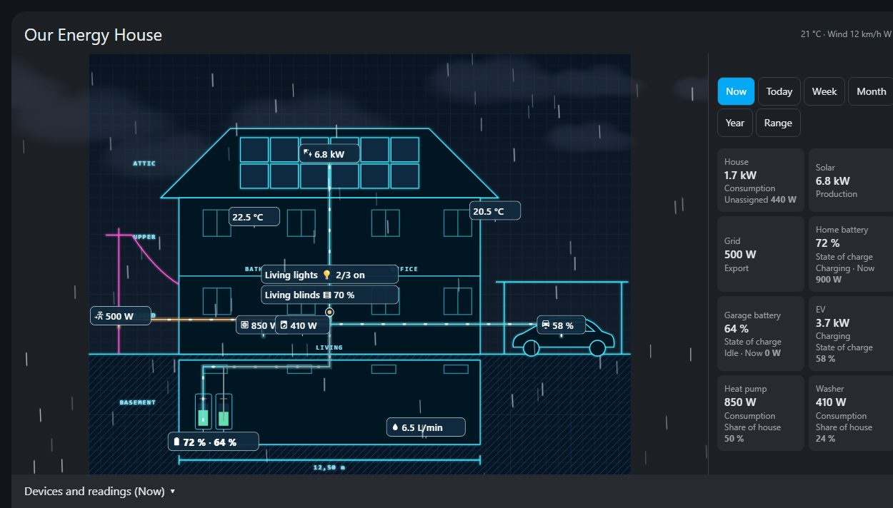 |

Picture styles: **3D · house with basement** (default, with seasons), **3D rendering**, **Blueprint · gable roof**, **Blueprint · flat roof**, **Schematic floor plan**, or **Own picture** from a URL such as `/local/house.webp` (3:2 format, place modules with Position X/Y). See [Picture options](#picture-options).

The four seasons follow the date:

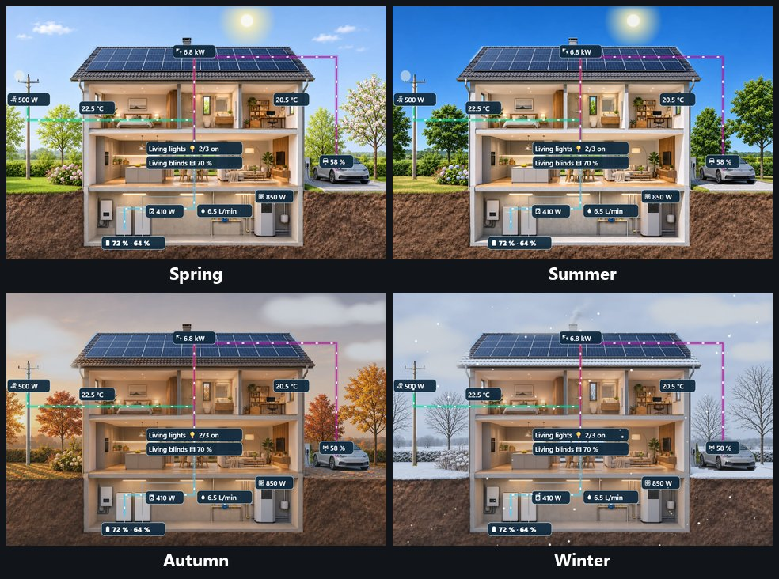

And the weather follows your weather entity:

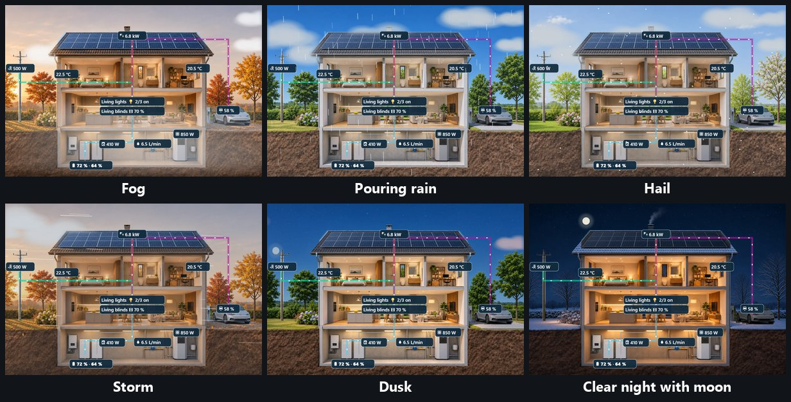

## Devices, readings and a check sum

Below the picture, **Devices and readings** opens tiles for every module and a list of every power sensor in Home Assistant. Sensors the card does not use yet are marked from 300 W (orange) and 1 kW (red), so unknown big consumers stand out. Hide sensors with ✕; the choice is saved per HA user. The check sum compares the sum of all consumers with the house consumption, so you can see how much of your usage is tracked.

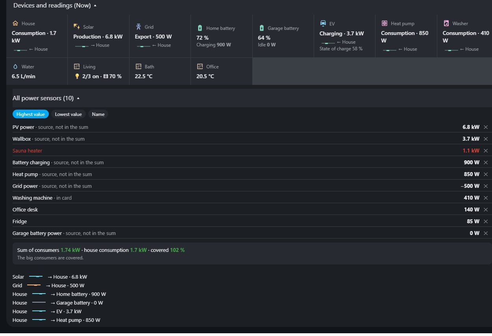

## Installation

### HACS (recommended)

1. Open HACS → menu (⋮) → **Custom repositories**.
2. Add `https://github.com/pfalzcraft/dynamic-energy-house-card` with type **Dashboard**.
3. Search for **Dynamic Energy House Card**, download it and reload the page.
4. Edit a dashboard → **Add card** → search for **Dynamic Energy House**. Or paste the YAML from `examples/minimal.yaml`.

HACS adds the resource `/hacsfiles/dynamic-energy-house-card/dynamic-energy-house-card.js` itself.

### Manual

1. Copy all files from `dist/` (`dynamic-energy-house-card.js` and the `dynamic-energy-house-card-*.webp` pictures) to `/config/www/`. Restart Home Assistant if `www` did not exist before.
2. As an administrator, go to Settings → Dashboards → Resources and add `/local/dynamic-energy-house-card.js` as a JavaScript module. Reload the page.
3. Add the card as above.

Without the `.webp` pictures next to the card file, the 3D house always shows the summer picture.

## Building your house

Open the card editor and work from top to bottom:

1. **Modules → Grid**: give it the grid power sensor. That alone already draws the house.
2. **Add module** for solar, batteries, vehicles, devices, water, rooms and grid CO₂. Each module adds its part to the picture and a tile below it. The tiles follow the order of the modules; change it with ▲ ▼ in the module's title. Routes can be reordered the same way; later routes are drawn on top.
3. **Routes**: connect modules with lines that show the power flowing between them.

The editor shows a short hint under every field. **Help** at the top of the editor and in the card editor's menu, and **What do these fields do?** in every section, lead to the reference below. The configuration belongs to the card and does not change anything in Home Assistant.

## Configuration reference

All fields can be set in the editor. The YAML key is given for people who prefer the code editor.

### Card options

| Field | YAML | What it does |
|---|---|---|
| Card title | `title` | Heading of the card. |
| Default period | `period` | `now`, `day`, `week`, `month` or `year`. The period the card opens with; viewers can switch it below the picture. |

### Picture options

| Field | YAML | What it does |
|---|---|---|
| Picture style | `look` | `cellar` 3D house with basement (default, changes with the seasons, shows heat pump, washer and dryer), `photo` 3D rendering, `blueprint` gable roof, `flat` flat roof, `custom` own picture. **Schematic floor plan** is stored as `view: diagram` and arranges the rooms by floor (basement, ground floor, upper floor, attic), four per row. |
| Picture URL | `image` | Only for the own picture: e.g. `/local/house.webp` in 3:2 format. Place modules with Position X/Y. |
| Preview buttons | `preview` | `yes` shows buttons below the picture to try time of day, weather and season. Default `no`. |

### Weather and sky options

| Field | YAML | What it does |
|---|---|---|
| Weather entity | `weather` | Clouds, rain, snow, hail, thunderstorms, fog and wind. |
| Sun | `sun` | Usually `sun.sun`. Day, night and dusk; sun and moon positions use your HA location. |
| Wind speed, wind direction, precipitation | `windSpeed`, `windDirection`, `precipitation` | Optional own sensors. Without them the weather entity's values are used. Direction in ° or as text. |

### Common module fields

Every module is an entry in `nodes` with a unique `id` and a `kind`. Entity fields suggest all matching entities from Home Assistant; type part of the ID or name to narrow the list.

| Field | YAML | What it does |
|---|---|---|
| Display name | `name` | Name in the picture label and the tile. |
| **Label in the picture** → Show name or icon | `showLabel` | `none` (default), `name` display name, `icon`, or `both`. |
| Icon | `icon` | Any `mdi:` icon for `icon` / `both`. Empty = the module's default icon. |
| Show value | `showState` | `yes` shows the current value in the label. |
| Position X / Y (%) | `x`, `y` | Moves the module's point in the picture. Empty = default place. Needed for an own picture; 0/0 is the top left corner. |
| **More options** → Sign | `invert` | `true` when your sensor reports the opposite direction (grid, solar, vehicle, device). |
| Control entity | `control` | Optional `select`, `input_select`, `switch`, `script` or `button`. Its options appear in the tile. A select option is only sent after a second tap; the card never writes set points by itself. |

Energy meters must count up (`state_class` `total` or `total_increasing`, Wh or kWh) and be in the HA long-term statistics. They are used for every period except **Now**; a module without a meter shows its momentary power there too.

### House module

No sensor. House consumption = solar + grid import − export + battery discharge − battery charge. Vehicle charging is part of it, like any other consumer. Live from the power sensors, for a period from the energy meters. Missing values are left out and named under “No value”. The tile shows how much of the consumption no device explains (“Unassigned”); a negative balance for a period means a meter does not fit.

### Grid module

| Field | YAML | What it does |
|---|---|---|
| Power | `entity` | W or kW, positive for import, negative for export. Separate import and export sensors can be combined with a template sensor (import minus export). |
| Import · energy meter | `energy` | Grid import per period. Also needed by the Grid CO₂ module. |
| Export · energy meter | `exported` | Export per period, shown below the import. |

### Solar module

| Field | YAML | What it does |
|---|---|---|
| Power | `entity` | Production in W or kW. |
| Production · energy meter | `energy` | Production per period. |

### Battery module

Any number of batteries.

| Field | YAML | What it does |
|---|---|---|
| State of charge | `soc` | Sensor in %. |
| Charged / Discharged · energy meter | `charged`, `discharged` | Energy per period. |

The live charging power is the sum of the routes with a power sensor that start or end at the battery.

### Vehicle module

| Field | YAML | What it does |
|---|---|---|
| Power | `entity` | Charging power in W or kW, positive while charging. |
| Charged · energy meter | `energy` | Optional. Takes precedence over the battery content for “charged”. |
| State of charge | `soc` | Optional. Shown in the picture label and the tile. |
| Battery content | `content` | Optional, kWh or %. From its history the card calculates energy charged and driven in the period: rises count as charged, drops as driven (including standby). |
| Battery capacity in kWh | `capacity` | Only when the battery content is in %. |

### Device module

Any number, e.g. heat pump, washer, dryer, fridge or office. Devices are part of the house consumption and are not used to calculate it.

| Field | YAML | What it does |
|---|---|---|
| Power | `entity` | Consumption in W or kW. |
| Consumption · energy meter | `energy` | Optional, e.g. from a Shelly. |
| Show in the picture | `scene` | `heatpump`, `washer` or `dryer` draws the device in the 3D house with basement. Empty = label only. |

### Water module

| Field | YAML | What it does |
|---|---|---|
| Water meter or flow sensor | `entity` | A meter (m³ or L, counting up) gives the consumption per period; a flow sensor the current flow (average of the last 10 minutes for “Now”). |
| Show | `waterMode` | Empty = automatic, `period` consumption in the period, `live` sensor value. |
| Unit | `waterUnit` | `m³` or `L`. |

### Room module

| Field | YAML | What it does |
|---|---|---|
| Floor | `floor` | `UG` basement, `EG` ground floor, `OG` upper floor, `DG` attic. Places the room in the picture and the floor plan. |
| **Label in the picture** → Show in the picture | `showState`, `showRoomName` | Nothing, room name, values, or room name and values. Values are one row per entity. Rooms have no icon. |
| Entity or group | `entities` | Lights, covers, switches, climate or sensors, or groups of them. Each gets a row in the label (lights on, average cover position, temperature). Tap a row to open its HA dialog; tap the room dot to switch its lights and covers. |
| Name in the label | `names` | Own short name per entity, e.g. `names: {light.living_group: Ceiling}`. Empty = the HA name. |
| Show name | `showNames` | Per entity `true` or `false`. Without a choice names are shown when the room has several entities. |

### Grid CO2 module

| Field | YAML | What it does |
|---|---|---|
| Fossil share of grid power | `entity` | Sensor in % from the “Electricity Maps” integration (as in the HA energy dashboard). |
| CO₂ intensity | `co2` | Optional extra line in the tile. |

Shows how much of the house consumption was low-carbon. Needs the import meter on the grid module and uses the current fossil share, not hourly values.

### Route fields

Routes (`routes`) are the lines the power runs along.

| Field | YAML | What it does |
|---|---|---|
| From / To | `from`, `to` | The module IDs the line connects. |
| Power From → To | `entity` | W or kW. Negative values reverse the arrow. |
| Power To → From | `reverse` | Optional second sensor, e.g. battery charging and discharging. The larger value sets the direction. |
| Height of the line (Y %) | `y` | Where the horizontal part runs. Empty = middle. Not used with waypoints. |
| Waypoints | `points` | Any number of points (`x`, `y` in %) the line runs through in order, e.g. `points: [{x: 70, y: 20}, {x: 86, y: 20}]`. Each one is reached first vertically, then horizontally; 0/0 is the top left corner. |
| Colour for positive / negative power | `positiveColor`, `negativeColor` | Line colours per direction. |

Routes run at right angles: vertically out of the module, horizontally at the height you set (or through the waypoints), vertically into the target. They may share lines. At 0 W or without a reading the line stays still; below 5 W the animation stops while the value stays visible. The card does not split surplus across routes by calculation.

### Periods and controls

Choose Now, Today, Week, Month, Year or Range below the picture. “Now” shows momentary power; every other period shows the energy from the energy meters, including the running hour. Range offers From/To dates (whole days in the HA time zone); the default is the last seven days.

Tap a module to open its HA dialog, or, for rooms and modules with a control entity, its controls directly below the picture. Background, tiles, buttons and text follow your HA theme (light or dark); only the value labels in the picture stay dark so they remain readable on the photo. Animations respect reduced motion.

## Repository

`dist/dynamic-energy-house-card.js` contains the custom element, renderer, editor and styles with no runtime dependencies and no build step. `assets/` holds the source pictures.

Documentation: [HA custom cards](https://developers.home-assistant.io/docs/frontend/custom-ui/custom-card/) · [HACS dashboard repositories](https://www.hacs.xyz/docs/publish/plugin/).

## License

MIT
