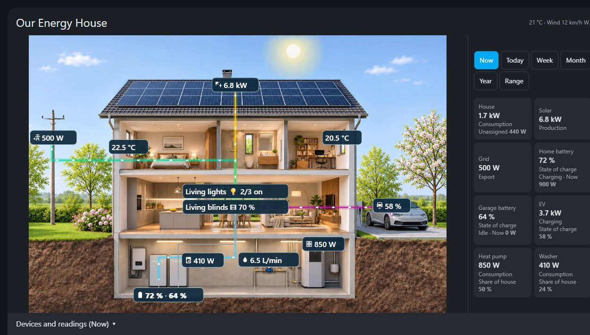
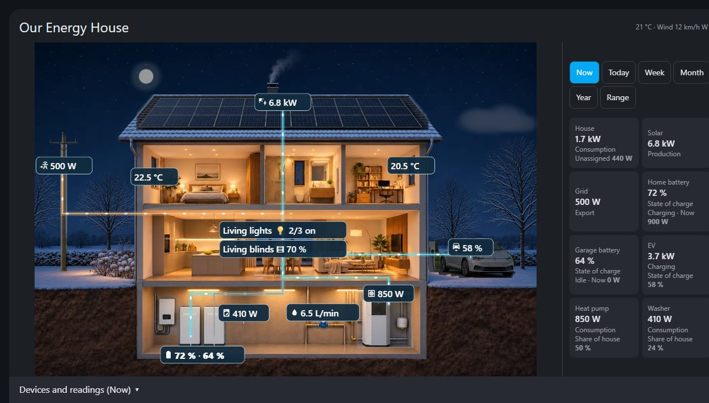

# Dynamic Energy House Card

A Home Assistant dashboard card that shows your home's energy flows on a cut-away house. Solar, grid, batteries, cars, heat pump, appliances, water and rooms appear in the picture only when you add them. Power flows run along routes you define, with your own colours and line positions. Weather, time of day, season, sun and moon are live.

## The picture follows your configuration

Start with nothing but the grid connection, then add modules. Each module brings its part of the picture: solar panels on the roof, the power pole, the car at the wallbox, battery cabinets and inverter, heat pump, washing machine, water meter, and a label for every room.

| Grid only | Everything added |
|---|---|
|  |  |

Rooms take any number of entities or groups: lights and light groups, covers and cover groups, switches, climate and sensors. Each entity gets its own row in the label (lights on, average cover position, temperature). Tap a row to open its HA dialog. Tap the room dot to switch the room's lights and covers.

## Routes and colours are yours

Routes are the lines the power runs along. You decide which modules they connect, which sensor measures them (one per direction if needed), the colour for positive and negative power, and the height of the horizontal line in the picture.

| Module settings | Route settings |
|---|---|
|  |  |

## Weather, seasons, sun and moon

The weather entity drives clouds, rain, snow, hail, thunderstorms, fog and wind. The season follows the date, day and night follow the sun with a blend at dusk. The sun and moon stand where they are in the sky, calculated from the time and your HA location (east is left). The moon only appears when it is above the horizon and shows its real phase.

| Night with moon | Blueprint style in the rain |
|---|---|
|  |  |

Picture styles: **3D · house with basement** (default, with seasons), **3D rendering**, **Blueprint · gable roof with basement**, **Blueprint · flat roof with basement**, or **Own picture** from a URL such as `/local/house.webp` (3:2 format, place modules with picture point X/Y).

## Devices, readings and a check sum

Below the picture, **Devices and readings** opens tiles for every module and a list of every power sensor in Home Assistant. Sensors the card does not use yet are marked from 300 W (orange) and 1 kW (red), so unknown big consumers stand out. Hide sensors with ✕; the choice is saved per HA user. The check sum compares the sum of all consumers with the house consumption, so you can see how much of your usage is tracked.

## Installation

### HACS (recommended)

1. Open HACS → menu (⋮) → **Custom repositories**.
2. Add `https://github.com/pfalzcraft/dynamic-energy-house-card` with type **Dashboard**.
3. Search for **Dynamic Energy House Card**, download it and reload the page.
4. Edit a dashboard → **Add card** → search for **Dynamic Energy House**. Or paste the YAML from `examples/minimal.yaml`.

HACS adds the resource `/hacsfiles/dynamic-energy-house-card/dynamic-energy-house-card.js` itself.

### Manual

1. Copy all files from `dist/` (`dynamic-energy-house-card.js` and the `dynamic-energy-house-card-*.webp` pictures) to `/config/www/`. Restart Home Assistant if `www` did not exist before.
2. As an administrator, go to Settings → Dashboards → Resources and add `/local/dynamic-energy-house-card.js` as a JavaScript module. Reload the page.
3. Add the card as above.

Without the `.webp` pictures next to the card file, the 3D house always shows the summer picture.

## Building your house

In the card editor, first give the grid connection its power sensor. The house consumption is calculated, not measured. Then use **Add module** for solar, any number of batteries, vehicles, devices, rooms, water and grid CO₂. HA area and device narrow down the entity suggestions; entity IDs can also be typed in. The configuration belongs to the card and does not change anything in Home Assistant.

| Module | Reading | Also |
|---|---|---|
| House | No sensor. Calculated: solar + grid import − export + battery discharge − battery charge − vehicle charging | Live from the power sensors, for a period from the energy meters. A battery's live power is the sum of its routes with a power sensor. Missing values are left out and named under “No value”. The tile shows how much of the consumption no device explains (“Unassigned”). |
| Grid | Two-way power, positive for import; energy meters for import and export | Sign can be inverted. The picture label shows import with `mdi:transmission-tower-export`; for a period the export (`mdi:transmission-tower-import`) appears below it once something was fed in. |
| Solar | Production power | One solar module. |
| Battery | State of charge in %, energy meters “Charged” and “Discharged” | Optional control entity for the operating mode. |
| Vehicle | Charging power, positive while charging; optional “Charged” energy meter; optional battery content (kWh, or % plus battery capacity) | From the battery content history the card calculates energy charged and driven in the period (rises count as charged, drops as driven, including standby). A dedicated charging meter takes precedence. With a state of charge, the picture label shows the %. |
| Device | Consumption power, optional energy meter (e.g. Shelly) | Any number. Part of the house consumption, not used to calculate it. Shown as heat pump, washing machine or dryer in the basement if you choose so. |
| Water | Meter reading (m³/L) or flow | Meters are recognised by `state_class` (total / total_increasing) or unit: consumption for a period, flow in L/min (average of the last 10 minutes) for “Now”. |
| Room | Any room sensor | Floor, HA area and any number of entities or groups. |
| Grid CO₂ | Fossil share of grid power in % (“Electricity Maps” integration, as in the HA energy dashboard), optional CO₂ intensity | Shows how much of the house consumption was low-carbon. Needs the grid import meter. Uses the current fossil share, not hourly values. |

Separate import and export sensors can be combined with an HA template sensor (import minus export, same unit; return `unavailable` if an input is missing). Energy meters (kWh) are not momentary power. Below 5 W the animation stops while the value stays visible.

### How routes work

Each route has a power field per direction (From → To, and optionally To → From). With one sensor it flows one way; with both, the larger value sets the direction, for example charging or discharging a battery. Negative power also reverses the arrow. At 0 W or without a reading the line stays still. Routes run at right angles: vertically out of the module, horizontally at the height you set (Y in %, empty = middle), vertically into the target. Routes may share lines. The card does not split surplus across routes by calculation.

### Periods and controls

Choose Now, Today, Week, Month, Year or Range. “Now” shows momentary power everywhere; every other period shows the energy from the energy meters, including the running hour. A module without an energy meter shows its momentary power there too. Range offers From/To dates (whole days in the HA time zone); the default is the last seven days. If the house balance for a period is negative, the house tile says so: then a meter does not fit.

Tap a module to open its HA dialog. With a control entity, a selection opens below the readings; for `select` and `input_select` it reads the real options from HA and only sends `select_option` after a second tap. The card never writes set points by itself.

The **Preview buttons** option in the editor shows buttons below the picture to try time of day, weather and season. Background, tiles, buttons and text follow your HA theme (light or dark); only the value labels in the picture stay dark so they remain readable on the photo. Animations respect reduced motion.

The schematic floor plan (House view → Schematic floor plan) builds floors from the rooms' floor setting (basement, ground floor, upper floor, attic), four rooms per row.

## Repository

`dist/dynamic-energy-house-card.js` contains the custom element, renderer, editor and styles with no runtime dependencies and no build step. `assets/` holds the source pictures. Dashboards set up with the earlier name `custom:energy-house-card` keep working.

Documentation: [HA custom cards](https://developers.home-assistant.io/docs/frontend/custom-ui/custom-card/) · [HACS dashboard repositories](https://www.hacs.xyz/docs/publish/plugin/).

## License

MIT
